<!-- HERO BANNER -->

  

<!-- ANIMATED TYPING ROLES -->

  <b>B.Tech in Computer Science Engineering (Artificial Intelligence &amp; Machine Learning)</b> 
  <i>Architecting high-performance backend microservices, resilient distributed pipelines, and predictive machine learning intelligence.</i>

<!-- SOCIAL BADGES & QUICK LINKS -->

  
  &nbsp;
  
  &nbsp;
  
  &nbsp;
  

<!-- ACTION CTA -->

  

<!-- SECTION DIVIDER -->

 

## 👨‍💻 About Me

I am a Software Engineer and AI/ML specialist with a solid foundation in **Computer Science Engineering (AI & ML)**. I bridge the gap between machine learning models and production-grade software by writing clean, test-driven, and highly maintainable systems.

- 🎓 **Education**: B.Tech in Computer Science Engineering (Artificial Intelligence & Machine Learning)
- 💼 **Primary Discipline**: Backend Architecture, REST API Engineering, and Predictive Machine Learning Systems
- 🛠️ **Engineering Principles**: Modular microservices, strong typing, deterministic testing, CI/CD automation, and zero-downtime reliability
- 🎯 **Career Objective**: Software Engineer (SDE) & AI/ML Engineer roles focused on high-scale distributed systems and data intelligence
- 💡 **Core Interests**: Distributed log streaming, vector search manifolds, automated replenishment intelligence, and containerized cloud runtimes

 

  <!-- INTERACTIVE TERMINAL & NEURAL CORE ILLUSTRATION -->
  

 

  

 

## 🔭 Current Learning and Focus Areas

My ongoing engineering research and deep dives center around scalable computational foundations:

- ⚡ **High-Throughput Distributed Backends**: Designing asynchronous event-driven services with FastAPI, connection pooling, Redis caching, and robust database indexing.
- 🧠 **Applied Intelligence & Telemetry Analytics**: Formulating multi-signal operational anomaly classifiers to minimize Mean Time to Resolution (MTTR) in complex service topologies.
- ☁️ **Containerization & Deployment Automation**: Hardening multi-stage Docker builds, managing container environments, and crafting automated GitHub Actions delivery pipelines.
- 📐 **Latent Memory & Unsupervised State Mapping**: Investigating cognitive memory mechanisms capable of discovering uncharted operational states in dynamic environments.

 

  

 

## 🛠️ Technology Stack

A curated overview of technologies, frameworks, and developer tooling utilized across production codebases:

### 💻 Programming & Query Languages

  
  
  
  
  
  
  

### 🧠 Artificial Intelligence & Data Science

  
  
  
  
  
  
  

### 🌐 Backend Engineering & Web Frameworks

  
  
  
  
  

### 🗄️ Database Management & Caching

  
  
  
  
  

### ☁️ Cloud, DevOps & Environment

  
  
  
  
  
  

### 🔧 Developer Workstation & Tooling

  
  
  
  

 

  

 

## 🚀 Featured Projects

Real, verified engineering initiatives emphasizing production software practices, predictive intelligence, and system reliability:

---

### 1. 📦 StockIQ — AI-Powered Supermarket Inventory Intelligence

> **Value Proposition:** An intelligent supermarket inventory risk and replenishment dashboard that predicts stockout events, assesses perishability decay, and automates reordering thresholds.

- **Status**: `Public Repository` • Active Codebase
- **Primary Technologies**: Python, Machine Learning, Data Analytics, Pandas, Scikit-Learn, Streamlit
- **Key Highlights**:
  - Analyzes historical turnover velocity to prevent costly retail stockouts and surplus spoilage.
  - Generates automated reorder quantity recommendations based on lead times and seasonal volatility.
  - Interactive visualization interface providing actionable inventory risk scorecards.
- **Repository**: [github.com/dhanush-m-c/stockiq-inventory-intelligence](https://github.com/dhanush-m-c/stockiq-inventory-intelligence)

---

### 2. 🛡️ AegisOps AI — IT Incident Intelligence & Root-Cause Observability

> **Value Proposition:** Autonomous IT operations intelligence engine designed to parse high-velocity streaming telemetry, detect cascading infrastructure anomalies, and isolate root causes in real time.

- **Status**: `In Active Development` • Upcoming Release
- **Primary Technologies**: Python, Machine Learning, REST APIs, Microservices Architecture, Docker, Telemetry Parsers
- **Key Highlights**:
  - Parses heterogeneous server and application log streams to compute multi-factor system health scores.
  - Correlates cross-service metric fluctuations to shorten incident triage and diagnostic overhead.
  - Container-ready service architecture built for modular integration into production observability stacks.
- **Repository Tracker**: [dhanush-m-c on GitHub](https://github.com/dhanush-m-c) *(Repository publication in progress)*

---

### 3. 🧠 TriMemory AI — Unknown Operational-State Discovery & Cognitive Memory

> **Value Proposition:** Research-oriented cognitive architecture investigating hierarchical memory layers to map high-dimensional latent manifolds and uncover uncataloged system operating states.

- **Status**: `Research & Prototype Phase` • Experimental Initiative
- **Primary Technologies**: Python, Cognitive AI Models, Temporal Graph Memory, High-Dimensional Vector Spaces, Unsupervised Learning
- **Key Highlights**:
  - Models tri-layer memory retention (sensory buffer, episodic trace, and semantic consolidation) for complex sequential workflows.
  - Identifies rare out-of-distribution behavioral patterns without relying on brittle rule-based heuristics.
  - Evaluates topological state transitions to detect latent edge-case degradation before system failure.
- **Research Tracker**: [dhanush-m-c on GitHub](https://github.com/dhanush-m-c) *(Prototyping & validation ongoing)*

---

### 4. 🍽️ Restaurant Website — Responsive Dining Platform

> **Value Proposition:** High-performance, mobile-first culinary web application featuring dynamic menu categorization, smooth animations, and optimized asset delivery.

- **Status**: `Public Repository` • Active Codebase
- **Primary Technologies**: HTML5, CSS3 / SCSS, JavaScript (ES6+), Bootstrap
- **Key Highlights**:
  - Fully responsive grid layout providing seamless usability across mobile, tablet, and desktop viewports.
  - Clean modular SCSS styling with customized interactive components and smooth hover states.
- **Repository**: [github.com/dhanush-m-c/restaurant-website](https://github.com/dhanush-m-c/restaurant-website)

 

  

 

## 📊 GitHub Statistics and Language Distribution

Real-time activity and language metrics generated dynamically via GitHub APIs:

  <table border="0" style="border: none; background: transparent;">
    <tr style="border: none; background: transparent;">
      <td width="50%" align="center" style="border: none; background: transparent;">
        
      </td>
      <td width="50%" align="center" style="border: none; background: transparent;">
        
      </td>
    </tr>
  </table>

 

  

 

## 🔥 Contribution Streak

Tracking continuous coding consistency and commit momentum across public repositories:

  

 

  

 

## 🐍 Animated Contribution Snake

Dynamic contribution visualization generated automatically every 12 hours via [Platane/snk](https://github.com/Platane/snk) and GitHub Actions:

  <picture>
    <source media="(prefers-color-scheme: dark)" srcset="https://raw.githubusercontent.com/dhanush-m-c/dhanush-m-c/output/github-contribution-grid-snake-dark.svg">
    <source media="(prefers-color-scheme: light)" srcset="https://raw.githubusercontent.com/dhanush-m-c/dhanush-m-c/output/github-contribution-grid-snake.svg">
    
  </picture>
   
  <i>⚡ Automated via GitHub Actions workflow running on schedule &bull; Generates custom neon snake animation on the output branch</i>

 

  

 

## 🎓 Research, Achievements & Academic Milestones

Verified technical focus and academic credentials:

- 🎓 **Undergraduate Degree**: B.Tech in Computer Science Engineering (Artificial Intelligence & Machine Learning)
  - Rigorous coursework in Data Structures & Algorithms, Database Management Systems, Distributed Computing, Artificial Intelligence, Deep Learning, and Operating Systems.
- 🔬 **Research & Applied Focus**:
  - Investigation into temporal multi-level memory models for automated system state discovery (**TriMemory AI**).
  - Applied machine learning pipelines for predictive perishability tracking and retail supply chain intelligence (**StockIQ**).
  - Telemetry log stream parsing and incident classification algorithms (**AegisOps AI**).
- 🏆 **Software Engineering Practices**:
  - Building end-to-end full-stack architectures with modular containerization and automated CI/CD workflows.
  - Committed to reproducible open-source codebases, comprehensive documentation, and deterministic testing.

 

  

 

## 📬 Contact and Collaboration

I am actively open to discussing full-time **Software Engineering**, **AI/ML Engineering**, and **Backend Development** opportunities. Feel free to connect or reach out directly:

  
  &nbsp;&nbsp;
  
  &nbsp;&nbsp;
  

 

<!-- CLOSING FOOTER BANNER -->

